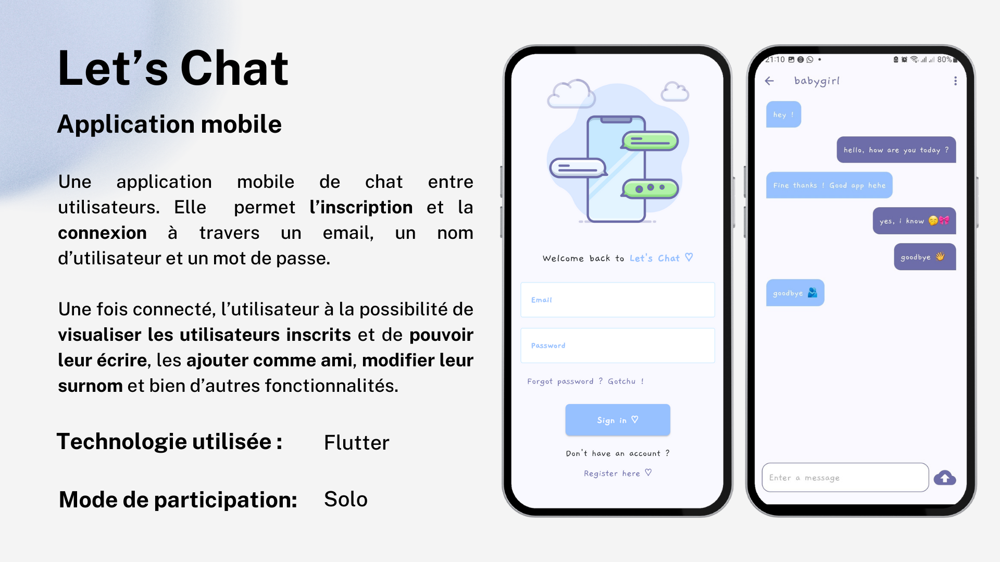

# Lets_chat 💬

A mobile chat application for users. It allows : 
- Registration and
- Login using an email, username, and password

Once logged in, users can view registered users, send messages, add them as friends, edit their nicknames, and access many other features.

You can download the .apk by checking the releases of this repository !

🚫 Ce projet est propriétaire. Aucune utilisation, copie ou distribution n'est autorisée sans permission explicite.
